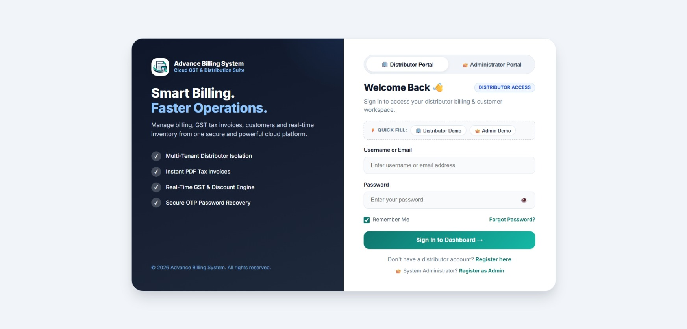
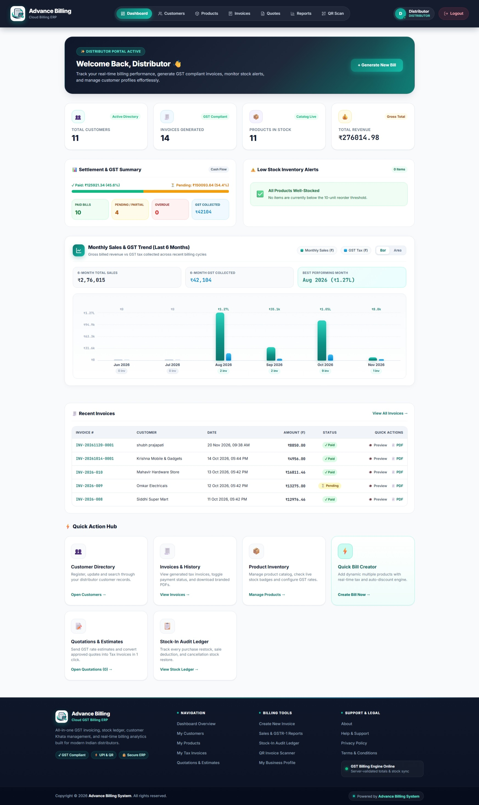
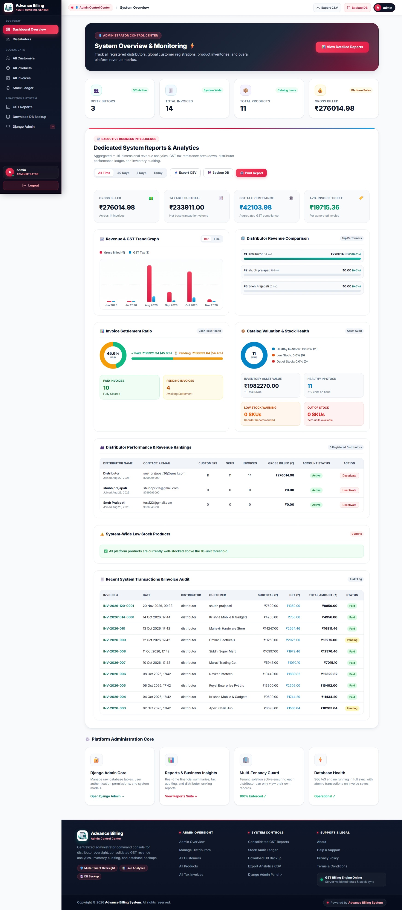

# Advance Billing System With QR

## Introduction

**Advance Billing System** is a modern, multi-tenant Indian GST billing, inventory, and distribution ERP web application built with **Python and Django**. It provides a complete digital billing platform enabling businesses and distributors to manage customers, track product inventory with stock-in audit logs, create multi-item GST tax invoices (CGST/SGST & IGST), record partial payments in a Customer Khata ledger, convert quotations to tax invoices in one click, generate branded A4 PDF invoices with UPI & verification QR codes, and export CA-ready GSTR-1 reports.

The platform implements **Role-Based Access Control (RBAC)** with strict multi-tenant data isolation across two dedicated portals:

- **Distributor Portal**: Manage customers & Khata (Udhar) ledger, product inventory & stock-in audit trail, fast POS tax invoicing, quotations/estimates, partial payments, QR invoice verification, date-range & GSTR-1 CSV/PDF reports, profile management, and interactive 6-month Sales & GST analytics.
- **Admin Portal**: Centralized control center with a fixed dark-navy left sidebar providing platform-wide KPIs, revenue & GST trend charts, distributor rankings & audit drill-down views, live broadcast announcements to all distributors, settlement & stock health analytics, system-wide low-stock watchlist, distributor activate/deactivate controls, CSV exports, and one-click database backups.

---

## Key Features

- **User Registration, Roles & Email OTP**: Separate Admin and Distributor login portals, 2-step distributor registration with Gmail SMTP OTP verification, session-based authentication, and 3-step OTP password recovery with rate limiting.
- **Customer Management & Khata Ledger**: Full customer CRUD with search, pagination, GSTIN validation, running Debit/Credit balance, overdue alerts, quick payment recording, WhatsApp due reminders, and CSV statement export.
- **Product Inventory & Stock-In Audit Ledger**: Product catalog with SKU, HSN/SAC codes, GST slabs, low-stock alerts, and full movement tracking (opening stock, purchase restocks, sales deductions, edit/cancellation restores).
- **Advanced GST Tax Invoicing**: Dynamic multi-row invoice creator with SKU quick-add, live intra-state (CGST+SGST) vs inter-state (IGST) calculation, server-side total validation, atomic stock locking, partial payments, and safe invoice editing/cancellation.
- **Quotations & 1-Click Conversion**: Create non-stock GST estimates/quotations, download PDFs, share via WhatsApp, and convert approved quotes into final Tax Invoices in one click.
- **Branded PDF Invoices & Dual QR Codes**: Instant A4 PDF generation (`xhtml2pdf`) with HSN-wise tax breakup, Indian Amount in Words, pre-filled UPI Scan & Pay QR code, Invoice Verification QR code, and direct email/WhatsApp sharing.
- **QR Code Scanner & Decoder**: Upload invoice/QR images to decode and verify authentic invoices directly against the database (`pyzbar` + Pillow).
- **Analytics Dashboards & GSTR-1 Reports**: Interactive Bar/Area monthly sales charts, date-range revenue & collection reports, PDF report export, and CA-ready GSTR-1 B2B / B2C / HSN CSV exports.
- **Admin Oversight & Live Broadcasts**: Fixed dark-navy Admin sidebar, per-distributor audit drill-down views, live system-wide announcements pushed to all Distributor dashboards, and 1-click JSON/SQLite database backups.

---

## Setup & Installation

### Prerequisites

> **Note:** Make sure **Python 3.10+**, **pip**, and **Git** are installed on your machine before running the setup commands. For `pyzbar` QR decoding on Ubuntu/Debian run `sudo apt-get install libzbar0`, and on macOS run `brew install zbar` (Windows includes it automatically).

### Installation on Windows

```powershell
# Clone the repository
git clone https://github.com/sneh125/advance-billing-system.git
cd advance-billing-system/Advance-Billing-System

# Create and activate virtual environment
python -m venv venv
.\venv\Scripts\Activate.ps1

# Install dependencies
pip install -r requirements.txt

# Configure environment variables (add Gmail SMTP credentials in .env for real email OTP)
copy .env.example .env

# Run database migrations
python manage.py makemigrations
python manage.py migrate

# Seed sample distributor, customers, products, and invoices (Optional)
python seed_data.py

# Create an admin superuser
python manage.py createsuperuser

# Start the development server
python manage.py runserver
```

### Installation on macOS / Linux

```bash
# Clone the repository
git clone https://github.com/sneh125/advance-billing-system.git
cd advance-billing-system/Advance-Billing-System

# Create and activate virtual environment
python3 -m venv venv
source venv/bin/activate

# Install dependencies
pip install -r requirements.txt

# Configure environment variables (add Gmail SMTP credentials in .env for real email OTP)
cp .env.example .env

# Run database migrations
python3 manage.py makemigrations
python3 manage.py migrate

# Seed sample distributor, customers, products, and invoices (Optional)
python3 seed_data.py

# Create an admin superuser
python3 manage.py createsuperuser

# Start the development server
python3 manage.py runserver
```

---

## Live Demo

- **Unified Login**: http://127.0.0.1:8000/login/
- **Admin Login**: http://127.0.0.1:8000/admin-login/
- **Distributor Login**: http://127.0.0.1:8000/distributor-login/

> See [DEPLOYMENT.md](Advance-Billing-System/DEPLOYMENT.md) for PythonAnywhere / Render / PostgreSQL production deployment instructions.

---

## Credentials

### Admin

- **Role:** System Administrator
- **Setup:** Create via `python manage.py createsuperuser` or register at `/admin-register/`
- **Portal URL:** `/admin-login/`

### Test User Credentials

| Role | Username | Email | Password |
| :--- | :--- | :--- | :--- |
| **Distributor (Seeded)** | `distributor` | `distributor@gmail.com` | `Dist@123` |
| **Admin (Superuser)** | `admin` | *Created via `createsuperuser`* | *Your chosen password* |

---

## Screenshots

### 1. Login Page



### 2. Distributor Dashboard & Monthly Sales Chart



### 3. Admin Dashboard


